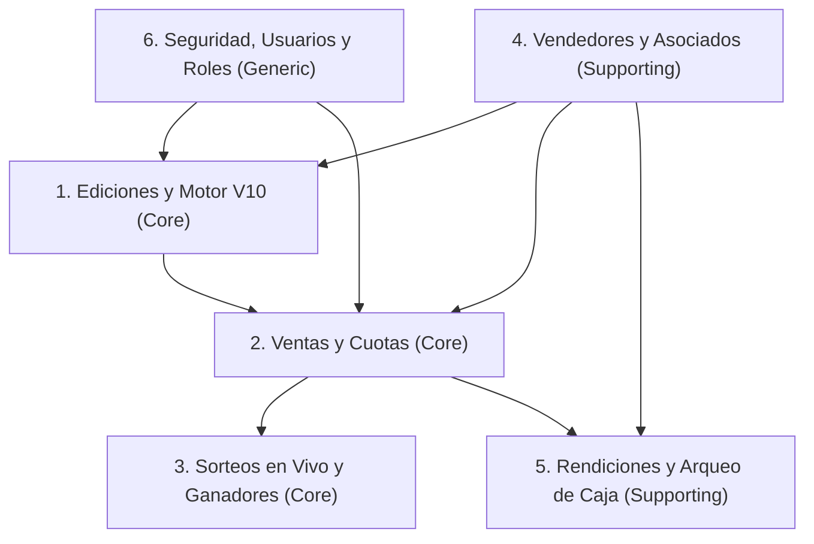

# 📘 System Blueprint: Gestión Tómbola (Fuente de Verdad del Negocio y Arquitectura)

**Estado:** Documento Vivo (Single Source of Truth)  
**Última actualización:** 2026-11-01

Este documento consolida el mapa de dominios, los modelos reales de base de datos, las reglas de negocio vigentes, las fórmulas contables y la matriz de roles del sistema **Gestión Tómbola**. Toda modificación funcional futura debe reflejarse aquí al cerrarse.

---

## 🗺️ 1. Panorama de Dominios y Flujo Operativo

1. **Ediciones y Cartones (`Core`):** Configuración de cada campaña (costo, plan de cuotas, fechas) y generación combinatoria de cartones mediante el **Motor Bingo Generator Pro V10**.
2. **Ventas y Finanzas / Cuotas (`Core`):** Vinculación de un cartón (`BingoCard`) con un asociado (`Client`) y un vendedor (`Seller`), generación automática del plan de cuotas (`Quota`) y seguimiento reactivo de pagos.
3. **Sorteos y Ganadores (`Core`):** Extracción de bolillas en vivo, cálculo de cartones escoltas (Top 10), validación en pantalla de TV según modalidad (`Cuota al Día` vs. `Contado`) y emisión de actas de ganadores.
4. **Vendedores y Asociados (`Supporting`):** Padrón único de personas (`Person`) compartido entre vendedores (`Seller`, con tasa de comisión) y compradores (`Client`).
5. **Rendiciones y Arqueo de Caja (`Supporting`):** Conciliación de entregas de dinero de vendedores (`SellerPayment`) e impacto contable automático en el libro mayor de ingresos y egresos (`Balance`).
6. **Seguridad, Autenticación y Roles (`Generic`):** Gestión de identidad (`User`), sesiones JWT (`httpOnly`) y control de acceso basado en roles (RBAC).

---

## 👥 2. Matriz de Roles, Actores y Dispositivos

El sistema está evolucionando de un esquema monopuesto local a una arquitectura **Cloud Multi-Rol y Multi-Dispositivo**:

| Rol | Estado Actual en Código | Objetivo Evolución Cloud / PWA | Dispositivo Principal |
| :--- | :--- | :--- | :--- |
| **`Administrador`** | **Activo** (`user.roles === 'Administrador'`). Acceso total y central a la gestión, finanzas, conciliación y auditoría. | Mantiene control total de ediciones, auditoría de caja, anulaciones, usuarios y configuración de sorteos. | 💻 Notebook HD (1366px) / Desktop |
| **`Vendedor`** | **Activo** (`user.roles === 'Vendedor'`). Conectado a `Seller` vía `User.seller`. | **Autogestión Mobile (PWA):** Rutas `/vendedor/*`. Ver únicamente sus cartones asignados, registrar ventas rápidas en <30s, cobrar cuotas de sus ventas y consultar balance por rendir a secretaría. Sin acceso a listado masivo de clientes. | 📱 Celular (PWA Touch-First) |
| **`Directiva`** | **Activo** (`user.roles === 'Directiva'`). | **Consulta Ejecutiva (Solo Lectura):** Acceso a `/directiva` y `/dashboard` (recaudación neta, colocación de cartones, cuotas al día/vencidas, ranking top vendedores, balance de caja) sin permisos de mutación o baja. | 📱 Celular / Tablet / Notebook |
| **Público / Presentador TV** | Pantallas de TV bajo login Admin. | **Landing Pública + Vistas TV:** Visualización de premios/sorteos y pantallas de proyección 100vh para el evento en vivo. Landing estrictamente institucional. | 📱 Celular / 📺 Smart TV (1080p) |

### Reglas de Contexto Compartido (Bounded Contexts)
* **`Person` es la entidad base de identidad física:** Tanto `User`, como `Seller` y `Client` referencian a un documento `Person` (`ref: 'Person', unique: true`).
* **Aislamiento de Vendedor:** Cuando un usuario con rol `Vendedor` se autentica, el sistema vincula `req.user.id` → `User.person` → `Seller.person`. En el backend, toda consulta de rol `Vendedor` debe filtrar obligatoriamente por su propio `seller._id` (jamás confiar en un `sellerId` enviado por query/body desde el cliente sin validar propiedad).

---

## 🗄️ 3. Modelos de Datos Reales (`src/models/`)

| Modelo | Archivo | Campos Clave y Relaciones | Estados / Enums Vigentes |
| :--- | :--- | :--- | :--- |
| **`Edition`** | `edition.model.js` | `name` (unique), `quantityCartons`, `cost`, `maxQuotas`, `installments[{ quotaNumber, dueDate, amount }]`, `totalBalls` (70), `clusterSize` (5), `clustersPerCard` (4), `cardSets` (5), `auditStats{ singleWinnerProb, avgFollowers }`, `user` | N/A |
| **`BingoCard`** | `bingoCard.model.js` | `edition`, `number`, `cardSets[{ setNumber: 1..5, numbers: [20 nros] }]`, `seller` (asignado), `user` | `status`: `'Disponible'` \| `'Vendido'` |
| **`Person`** | `person.model.js` | `firstName`, `lastName`, `document`, `address`, `city`, `phone`, `email` | N/A |
| **`Seller`** | `seller.model.js` | `sellerNumber` (auto-inc), `person` (unique), `commissionRate` (0..100), `isParticular` (Boolean) | `status`: `'Activo'` \| `'Inactivo'` |
| **`Client`** | `client.model.js` | `clientNumber` (auto-inc), `person` (unique), `notes` | `status`: `'Activo'` \| `'Inactivo'` |
| **`Sale`** | `sale.model.js` | `saleNumber` (auto-inc), `edition`, `seller`, `client`, `bingoCard`, `saleDate`, `lastFullPayment`, `cardPaymentDetails{ cardHolder, cardNumber, cardPlan, cardAmount, authCode }`, `user` | `status`: `'Pendiente de pago'` \| `'Pagado'` \| `'Anulada'` \| `'Entregado sin cargo'` `fullPaymentMethod`: `'Efectivo'` \| `'Tarjeta'` \| `'Transferencia'` \| `'Cheque'` \| `'Otro'` |
| **`Quota`** | `quota.model.js` | `sale`, `quotaNumber`, `dueDate`, `amount`, `paymentDate` | `paymentMethod`: `'Efectivo'` \| `'Tarjeta'` \| `'Transferencia'` \| `'Otro'` *(+ `'Entregado sin cargo'` en bonificaciones)* |
| **`SellerPayment`** | `sellerPayment.model.js` | `sellerPaymentNumber` (auto-inc), `edition`, `seller`, `cashAmount`, `transferAmount`, `tarjetaUnicaAmount`, `checks[{ checkNumber, bank, branch, date, amount }]`, `checkAmount` (pre-save), `commissionRate`, `commissionAmount`, `date`, `reference`, `observations`, `createdBy`, `canceledBy`, `canceledAt` | `commissionType`: `'Efectivo'` \| `'Transferencia'` `status`: `'Activo'` \| `'Anulado'` |
| **`Balance`** | `balance.model.js` | `transactionNumber` (auto-inc), `edition`, `date`, `counterpart`, `concept`, `cashAmount`, `transferAmount`, `tarjetaUnicaAmount`, `checks[]`, `checkAmount` (pre-save), `totalAmount` (pre-save), `sellerPaymentRef`, `taxPercentage`, `totalRenderedAmount`, `taxPaymentDate`, `declarationDate`, `createdBy`, `canceledBy`, `canceledAt` | `type`: `'Ingreso'` \| `'Egreso'` `status`: `'Activo'` \| `'Anulado'` `category` (ver §4.4 y §4.5) |
| **`Draw`** | `draw.model.js` | `edition`, `drawDate`, `description`, `cardSetNumber` (1..5 si `Final`), `drawnNumbers: [Number]`, `prizes[{ position, description, bingoCard, sale, winnerRegisteredAt, notes }]`, `user` | `type`: `'Mensual'` \| `'Final'` `status`: `'Programado'` \| `'En curso'` \| `'Finalizado'` |
| **`User`** | `user.model.js` | `username` (unique), `email` (unique), `password` (hash bcrypt), `person` (unique), `seller` (ref: 'Seller', sparse: true) | `roles`: `'Administrador'` \| `'Vendedor'` \| `'Directiva'` `status`: `'Activo'` \| `'Inactivo'` |
| **`Counter`** | `counter.model.js` | `model` (unique), `seq` (secuencias atómicas `$inc` para `saleNumber`, `sellerNumber`, `clientNumber`, `sellerPaymentNumber`, `transactionNumber`) | N/A |

> ✅ **Saneamiento completado:** El modelo legacy `Installment` fue eliminado por completo, consolidando todas las cuotas en el modelo `Quota`.

---

## ⚖️ 4. Reglas de Negocio y Fórmulas Contables Vigentes

### 4.1 Motor de Generación de Cartones (Bingo Generator Pro V10 — `edition.controllers.js`)
* **Diseño por Estratos Combinatorios:**
  * Universo por defecto: `totalBalls = 70`, agrupadas en clústeres de `clusterSize = 5` ($N_c = 70 / 5 = 14$ clústeres).
  * Cada cartón toma `clustersPerCard = 4` clústeres ($4 \times 5 = 20$ números por ronda).
  * Cantidad total de combinaciones únicas sin repetir:
    $$\binom{N_c}{\text{clustersPerCard}} = \binom{14}{4} = 1.001 \text{ cartones}$$
  * Cada cartón posee `cardSets = 5` juegos independientes de 20 números (para 5 sorteos finales distintos con el mismo cartón físico).
* **Auditoría Monte Carlo y Barajado:**
  * Al crear la edición, `auditV10` ejecuta 1.000 sorteos simulados calculando `singleWinnerProb` (probabilidad de ganador único sin empate) y `avgFollowers` (promedio de cartones a 1 bolilla al salir bingo).
  * Los cartones se barajan aleatoriamente (`shuffleArray`) antes de numerarse de $1 \dots N$ para evitar que cartones con números correlativos (entregados al mismo vendedor) compartan los mismos clústeres.

### 4.2 Ciclo de Vida de Ventas y Cuotas (`sale.controllers.js` y `quota.controllers.js`)
* **RN-VEN-01 (Alta de Venta):** Al registrar una venta (`createSale`), el `BingoCard` asociado cambia su estado a `'Vendido'` y se generan automáticamente tantas cuotas (`Quota`) como defina `edition.installments`, copiando `quotaNumber`, `dueDate` y `amount`, con `paymentDate: null`.
* **RN-VEN-02 (Transición Automática a Pagado):** Cada vez que se actualiza una cuota (`updateQuota`), el sistema verifica todas las cuotas de esa venta (`Quota.find({ sale })`):
  * Si **todas** tienen `paymentDate !== null`, `sale.status` pasa automáticamente a `'Pagado'` (respetando `'Entregado sin cargo'` si fue bonificada).
  * Si al menos una cuota vuelve a `paymentDate: null`, `sale.status` regresa a `'Pendiente de pago'`.
* **RN-VEN-03 (Anulación con Liberación de Stock):** Una venta no se borra en producción; al anularla (`cancelSale`), `sale.status` pasa a `'Anulada'` y el `BingoCard` vuelve automáticamente a `'Disponible'` para poder revenderse a otro asociado.

### 4.3 Reglas de Sorteo en Vivo y Consulta TV (`bingoCard.controllers.js` y `BingoCardStatusPage.jsx`)
* **RN-SOR-01 (Estado de Cartón):** Un cartón está `sold = true` si tiene una `Sale` en esa edición con `status !== 'Anulada'`.
* **RN-SOR-02 (Cuota al Día — `upToDate`):** Un cartón vendido está al día si no posee ninguna cuota vencida impaga (`dueDate < hoy` con `paymentDate === null`).
* **RN-SOR-03 (Modalidades de Sorteo en TV):**
  * **Modo `Sorteo Cuota al Día` (`drawMode === 'cuota'`):** Participa y es válido como ganador si `sold && upToDate`.
  * **Modo `Sorteo Pago de Contado` (`drawMode === 'contado'`):** Participa únicamente si `sold && plan === 'Pago contado'` (100% de las cuotas saldadas).
* **RN-SOR-04 (Wording Amigable en TV):** En pantallas públicas queda prohibido usar términos punitivos como `"Solicitud con Deuda"`. Los mensajes oficiales son:
  * No vendido: `"No participa – Solicitud no vendida"`
  * Cuotas vencidas (modo cuota): `"No participa – Cuotas pendientes"`
  * No cancelado al 100% (modo contado): `"No participa – Pago de contado incompleto"`

### 4.4 Fórmulas de Rendiciones de Vendedores e Impacto en Caja (`sellerPayment.controllers.js` y `balance.controllers.js`)
* **RN-REN-01 (Cálculo de Rendición):**
  $$\text{Subtotal Bruto} = \text{cashAmount} + \text{transferAmount} + \text{tarjetaUnicaAmount} + \sum \text{checks.amount}$$
  $$\text{Monto Comisión} = \frac{\text{Subtotal Bruto} \times \text{commissionRate}}{100}$$
  $$\text{Total Neto a Rendir} = \text{Subtotal Bruto} - \text{Monto Comisión}$$
* **RN-REN-02 (Asiento Doble Automático en `Balance`):**
  Al crear un `SellerPayment`, el backend genera automáticamente en el Arqueo de Caja (`Balance`):
  1. **1 Movimiento de `Ingreso`** (categoría `'Rendición de Vendedor'`) por el $\text{Subtotal Bruto}$, discriminando cada medio de pago y cheques.
  2. **1 Movimiento de `Egreso`** (categoría `'Comisión de Vendedor'`, si `commissionAmount > 0`) imputado a `cashAmount` o `transferAmount` según `commissionType`.
* **RN-REN-03 (Sincronización en Cascada):**
  * Editar `commissionType` en la rendición actualiza automáticamente los importes del movimiento de `Egreso` en `Balance`.
  * Anular (`cancelSellerPayment`) o eliminar (`deleteSellerPayment`) una rendición anula o elimina en cascada sus movimientos asociados en `Balance` (`sellerPaymentRef`).
* **RN-REN-04 (Idempotencia Anti-Doble Envío):**
  El backend rechaza con `409 Conflict` cualquier intento de crear un `SellerPayment` para el mismo `seller`, `edition` e idénticos montos dentro de una ventana de **10 segundos**.

### 4.5 Regla de Impuesto de Lotería (`BalanceFormPage.jsx` / `balance.model.js`)
* Cuando se registra un `Egreso` con categoría `'Lotería'`:
  * La contraparte se fija en `"Lotería de la Provincia de Córdoba S.E."`.
  * Porcentaje por defecto: `taxPercentage = 6.5420%`.
  * Fórmula:
    $$\text{Impuesto Calculado} = \frac{\text{totalRenderedAmount} \times \text{taxPercentage}}{100}$$
  * La suma de los medios de pago cargados debe coincidir con el $\text{Impuesto Calculado}$ (tolerancia máxima de redondeo: $\pm \$0,02$).

### 4.6 Reglas Analíticas del Reporte General (`dashboard.controllers.js`)
* **Exclusión de Anuladas:** Toda venta o movimiento con estado `'Anulada'` / `'Anulado'` se excluye del 100% de los KPIs operativos y financieros.
* **Clasificación de Ventas en Dashboard:**
  * `Sin Cargo`: `sale.status === 'Entregado sin cargo'`.
  * `Contado`: Todas las cuotas de la venta están pagas (`paymentDate !== null`) **y** fueron abonadas en el **mismo día calendario**.
  * `Cuotas`: Ventas activas con cuotas pendientes o con pagos realizados en distintos días.
* **Recaudación Esperada de la Edición:**
  $$\text{Recaudación Esperada} = (\text{edition.quantityCartons} - \text{Ventas Sin Cargo}) \times \text{edition.cost}$$
* **Criterio de Nuevos Asociados (Earliest Sale Criterion):** Un comprador cuenta como *"Nuevo Asociado"* en la edición actual únicamente si su primera compra histórica válida en toda la base de datos pertenece a esta edición.
* **Normalización Geográfica:** Las localidades (`person.city`) se agrupan ignorando tildes y mayúsculas/minúsculas (`NFD`), mostrando en la UI la variante con mejor ortografía (con tilde y *Capital Case*).

### 4.7 Reglas de Seguridad Multi-Rol y Operatoria Móvil PWA (`vendedor.controllers.js`, `role.middleware.js`, `sellerScope.js`)
* **RN-ROL-01 (Aislamiento de Vendedor):** Cuando un usuario con rol `Vendedor` accede a endpoints dedicados de campo (`/api/vendedor/*`), el backend inyecta automáticamente su `sellerId` desde el token verificado (`req.sellerId`). Todo acceso a cartones, cuotas o métricas queda circunscripto exclusivamente a su asignación y ventas propias.
* **RN-ROL-02 (Protección Estricta del Padrón de Clientes / Anti-Poaching):** Los usuarios con rol `Vendedor` tienen terminantemente prohibido listar masivamente la base de clientes (`GET /api/clients` responde `403 Forbidden`). Solo disponen de búsqueda puntual dirigida por DNI/Apellido (`GET /api/clients/search?q=...`, mínimo 3 caracteres, límite 5) y alta inmediata de un nuevo asociado (`POST /api/clients`).
* **RN-ROL-03 (Venta Rápida de Campo):** Los vendedores solo pueden comercializar cartones que tengan asignados previamente por secretaría (`BingoCard.seller === req.sellerId`) y que se encuentren en estado `Disponible`. Al vender, se genera la venta y las cuotas de forma atómica.
* **RN-ROL-04 (Cobro Presencial de Cuotas):** Al registrar una cobranza de cuota desde la PWA (`POST /api/vendedor/quota-payment`), el sistema registra la fecha de pago y método (`Efectivo` o `Transferencia`). Si se saldan todas las cuotas, la venta transiciona automáticamente a `Pagado`.
* **RN-ROL-05 (Inmutabilidad de Campo):** La aplicación móvil para vendedores es estrictamente **aditiva** (vende, cobra cuotas, consulta métricas). No incluye botones de anulación, edición ni borrado de transacciones para evitar inconsistencias en la calle.
* **RN-ROL-06 (Flexibilidad y Conciliación Central):** El Administrador conserva todas las herramientas tradicionales en el panel central de escritorio (Notebook HD) para realizar ajustes contables, anular ventas con liberación de stock o registrar rendiciones periódicas.
* **RN-ROL-07 (Operación Siempre Online para Transacciones):** Se excluyó deliberadamente la sincronización bidireccional offline para prevenir colisiones de números o ventas duplicadas en el club. La PWA cachea assets estáticos (Service Worker), pero las operaciones financieras requieren conexión de datos móviles o Wi-Fi.
* **RN-ROL-08 (Rol Directiva Solo Lectura):** Los directivos tienen acceso exclusivo de consulta al tablero ejecutivo (`/directiva` y `/dashboard`). Toda mutación (`POST`, `PUT`, `DELETE`) en endpoints administrativos responde `403 Forbidden`.
* **RN-ROL-09 (Vinculación Obligatoria Usuario-Vendedor):** Un usuario con rol `Vendedor` no puede existir de forma huérfana; debe estar indefectiblemente vinculado a un documento `Seller` (`seller: ObjectId`). Los usuarios `Administrador` y `Directiva` mantienen `seller: null`.
